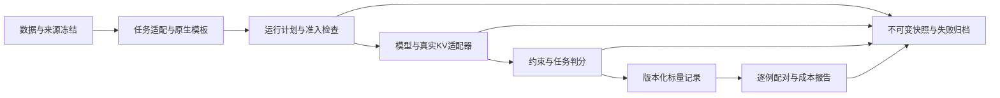

# KV输出约束可靠性评测系统：第一版设计

2026-10-30最新：[同生成器检查点恢复与DEV集成](runs/20261030-hf-DEV-acceptance.md)完成，来源/evidence重新核验后恢复14观测、当前工程cap0，未改原offer_evidence。生成器scope不变，控制/评分协议单独hash；36新DEV、20预算阻止、4保护证据阻止汇入60格报告，原始先存再校验/判分。v1配置JSON键类型误报失败0生成保留；v2只将完整config JSON规范化比较，没有跳字段。独立文本判分36/trace1115步/map2688/排名1344与分母/F1/上下界一致。系统主链通过范围内集成验收，不等跨任务/第二模型/性能或独立科学确认。下一步整理独立实证最小协议，当前无GPU队列。

2026-10-30最新：[HF后端工程GPU验收](runs/20261030-hf-backend-engineering.md)在固定Qwen/两题上通过，14回答605token、3条件有新scope真实证据，2保护条件仍不可行/unverified。新注册digest绑定GPU协议/runner及parent dry scope，未复用旧观测。observer先存raw再交编排，独立验证原始/accepted、14新旧输出、563位置trace步/448map/224排名及4权重通过。无DEV/封存输出；36准入只是计划。下一步冻结36格DEV端到端验收以接任务/格式评分与统一归档，不把工程复现当独立实证或通用/性能验证。

2026-10-30最新：[HF编排壳/延迟后端](HF_ORCHESTRATION_20261030.md)代码已接线，22项CPU检查通过。冻结输入和context_group_id后，bootstrap按预算/角色/注册调度工程；DEV按同版本同条件工程证据准入；后端仅最后边界加载。新scope旧5证据全拒，14工程调用待执行/4保护格不可行；60DEV为20预算阻止+40待新工程。干运行不生成通过证据，也未加载torch/HF/模型。当前后端仅固定Qwen2.5-7B Full28/GQA4/BF16/半预算，不称跨模型通用或GPU验证通过；下一步另冻14工程回答/0DEV协议，旧producer与历史结果保持。

2026-10-30实现更新：[条件级执行合同](CONDITION_ADMISSION_20261030.md)已新增，20软件用例/60格CPU验收与独立回读通过。budget、工程evidence、admission、execution、metrics分层，明确36未来可准入、20预算阻止、4证据未验阻止，历史4保护诊断保留。该dispatcher只用软件stub验收，尚未接真实HF；下一步新编排壳只dry-run并区分bootstrap工程stage与正式运行准入，旧producer/分数/关卡不改。当前不进行新推理、封存或矩阵扩展。

2026-10-30。用户要求开始系统设计与实证。本版目标是把已有的可运行脚本转成接口明确、可单独验收的离线系统。第一项交付为跨任务的标量契约/预算规划/配对报告，已在服务器通过归档验收；生成后端仍为固定Qwen2.5适配器，不能称通用平台已完成。

研究问题：相同实际prefix KV字节下，策略与完整指令保护如何分别影响约束遵守、任务能力和完成率？报告怎样保留成本、截断、失败与未知，防止把格式合法当正确、把净分当无损？系统本身不是新压缩算法；实验结果不预设保护有效或方法排名。

## 架构与依赖方向

先交付CLI与可复核工件，不以网页展示代替核心工作。标量契约/报告只依赖Python标准库；任务评分依赖任务定义；后端才导入Torch/HF。禁止报告层调用生成器、读取pickle/模型张量或为缺失分数猜答案。不同层的源码/输入/输出SHA分别记录，修改一种接口不静默改旧数据。

| 模块 | 接口输入→输出 | 当前状态与验收 |
| --- | --- | --- |
| 来源与分组 | 固定文件/版本→source manifest、context group、split role | 已有SQuAD准备器验证；新数据须另取固定源、跨历史数据去重 |
| 任务适配器 | 原始样本→messages、gold引用、指标定义 | 已有TREC与span-QA；BoolQ待独立实现与fixture |
| 原生前端 | messages+tokenizer→input ids、prefix/suffix、保护token集合 | Qwen版已验；第二模型须用自身原生模板，不能注入Qwen标记 |
| KV布局/预算核心 | 每层K/V实际布局描述+保留比例+保护/锚点→字节/可行预算 | 新`reliability_system_core.kv_layout/budget_plan`已过软件验收；描述符计算不等新模型张量已验证 |
| 模型/裁剪后端 | 固定input ids+score-only选择器→raw输出、map、trace、实际KV观测 | 旧Qwen28/4版本已验；通用形状/多模型适配未完成 |
| 约束/任务评分 | 完整raw与gold→独立格式bool、任务bool/F1、N/A及原因 | QA已验24用例，TREC保持旧语义，不强行合并指标 |
| 标量适配器 | 旧归档格式→统一schema与指标版本 | 新`reliability_system_adapters`覆盖两类归档；只搬运既有判分，不重新解码 |
| 报告核心 | 明确case×condition计划+记录→计数、转移、分母、范围、成本 | 新`summarize`覆盖两类任务/三cohort，290条旧记录验收通过 |
| 执行/归档 | 冻结proposal+stage gate→新run目录/snapshot/manifest | 现有runner已分阶段，尚待统一执行壳；不可覆盖旧run |

## 核心数据契约

schema版本`kv_reliability_scalar_v1`。唯一键为`cohort_id/case_id/condition_id`；同键重复、计划外记录、Full与方法输入/gold/比较配置digest不一致一律拒绝。每个metric包含`metric_id/kind/value/reason`；kind是boolean或unit_interval，拒绝bool冒充连续分与NaN/Infinity。指标版本不同不能配对，任务不存在的F1不补0。

成功执行记录必须有truncated布尔值、输入/gold/comparison digest、实际prefix KV字节。状态区分ok、error、not_run、infeasible_budget；truncated与状态正交。计划中缺cell显示not_run，不靠已有成功行决定计划大小。归档验收的计划从已固定历史身份枚举，只允许称回放；未来确认计划在输出前冻结，不能用适配器从结果反推。

`comparison_digest`绑定模型snapshot、tokenizer/template、解码和非干预条件。QA归档回放已核Full/压缩实际snapshot的model/decode/layout一致；TREC引用先前已验证的归档身份审计，标明本轮未重新验证其模型运行。不能用同名方法或任意常量digest假装新实验已可比较。

context_group与split_role随source manifest保存。相关query、共享示例及同源文章不作为独立样本。TREC分组独立性未知时group_count为null；QA16个开发文章组可识别，但仍是开发数据。三组报告不合并总体分数或置信区间。

## 预算与实际资源

布局描述每层的Full Attention类型、batch、K/V heads、dimension、element_bytes，逐层求`K+V`字节。MHA/GQA与层数不写死；第一版只支持batch1、等保留槽数的FP16/BF16/FP32普通张量描述，分页、量化、卸载、重算和recurrent state明确不在该接口支持范围。

保留比例用精确字符串如`1/2`，floor后得到requested/effective slots；完整保护与sink/recent作集合并集，一次计费。若超预算记infeasible，不能增预算/部分保护/加文本。相同case、model、budget group的压缩条件必须有相同观测prefix字节；跨模型相同比例不宣称相同绝对成本。

运行适配器还必须验证实际张量形状/dtype、gather逐值相等、保留原RoPE逻辑位置与紧凑物理cache位置、reference不被分支修改。布局函数本身只验描述符，不将软件MHA/GQA例子写成新模型运行证据。

成本分三层：实际prefix/最终live KV，额外评分/索引/复制buffer，以及allocator allocated/reserved峰值和同步计时。未知均为null及原因。审计模式保留Full reference+compact，禁止用半prefix字节推整进程减半；生产式成本测量须单分支释放reference后重测，独立run、固定输入与输出条件，不拿审计wall时间当速度。

## 报告定义

- 每种约束/任务指标分别报可评估数、缺失/错误/截断/不适用原因；严格配对排除截断但保留raw值与数量。
- 布尔指标报C2C/C2W/W2C/W2W、全部可用Full正确数D、可比较Full正确数E、未评估数U。严格损坏=C2W/E；全Full正确覆盖范围为`[C2W/D,(C2W+U)/D]`，D或E为0时相应率null。范围不是置信区间。
- 连续分报适用均值、分母与同case差值均值，不套布尔转移。F1/EM与格式分别解释，不能把schema通过当内容正确。
- 保护与对应无保护逐例比较，任务净分相同时仍报损坏/改善。独立模型/任务/预算/seed分别报告，不先挑获胜方法再合并确认。
- 新前瞻协议可以定义“预算内完整且两项通过”的端到端交付指标，截断计交付失败；这不把未知语义分硬填false，也不追改旧关卡。新指标先冻再测。

## 状态机与失败处理

`planned → data_verified → frontend_verified → engineering_passed → Full_measured → compressed_measured → analysis_verified`。数据/模板/张量/路径一致性错误停止对应stage，失败与not_run全留档。Full错题不删；Full最低支持量由任务前瞻协议定义，只决定可否支持细粒度分析，不据此修提示/换题。

旧QA的全条件无截断关卡false继续保留，旧封存16不恢复。新的系统实证需要把截断/无输出作为要测的结果，并通过覆盖范围处理不确定性，不能一出现退化就只保留完整项。旧关卡不会因此变true；新协议使用新来源/划分和结果目录。

## 第一版验收与后续实证

[本轮服务器验收](runs/20261030-reliability-system-archive.md)：8固定输入840461bytes/324源JSONL行，适配290条唯一记录，三cohort全部严格计数/转移/分母/F1复现，16软件检查通过；外层独立Counter/连续差值/未知成本回读通过。0新模型输出，无模型库/GPU/环境变更。四新模块与旧生成/分析脚本分离，旧分数与gate不改。

尚未交付：统一HF运行壳、多任务原生前端、第二模型KV hook、生产式成本计量、独立实证和功效充分的总体推断。下一步按[实证方案](RELIABILITY_EMPIRICAL_PLAN_20261030.md)先固定新数据来源与判分/分组，完成新任务CPU验证后再注册GPU小试。系统工作量以这些模块及验收衡量，不以累计run数或界面规模衡量。
